# DEADBALL

A Playdate game: a shared, simulated online baseball league you bet on, rig and read about
(with BallCast 3D replays), plus Pennant '96, an offline season mode.

<p align="center">
  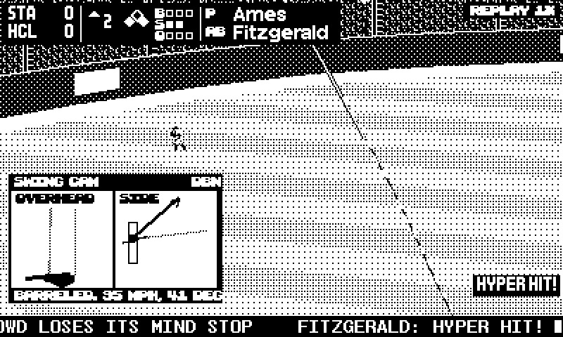
  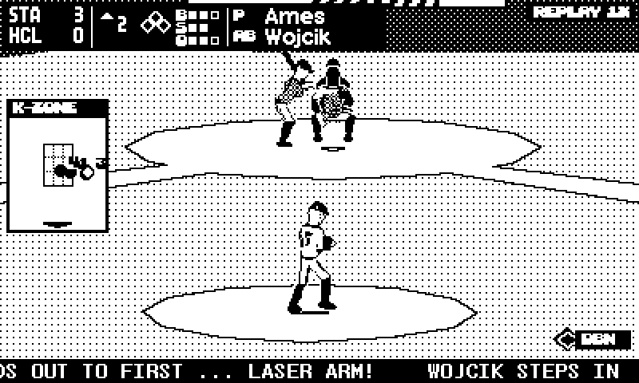
</p>

<p align="center">
  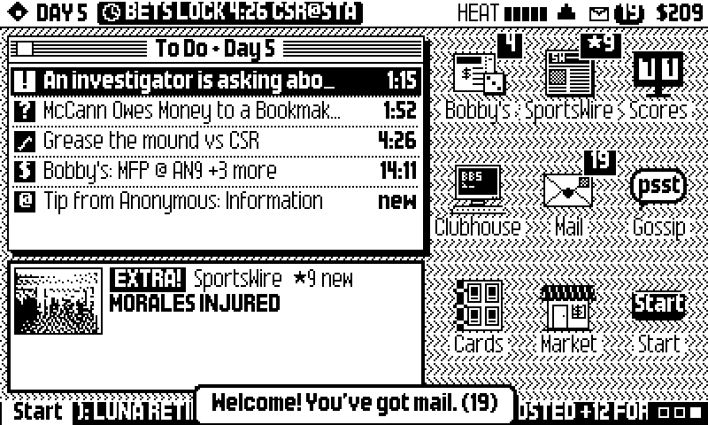
  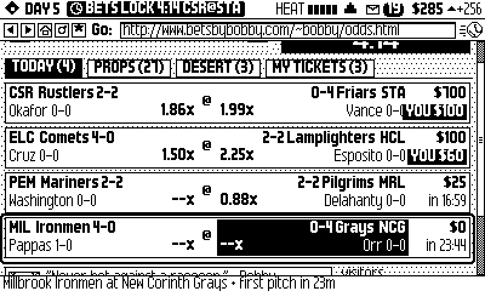
  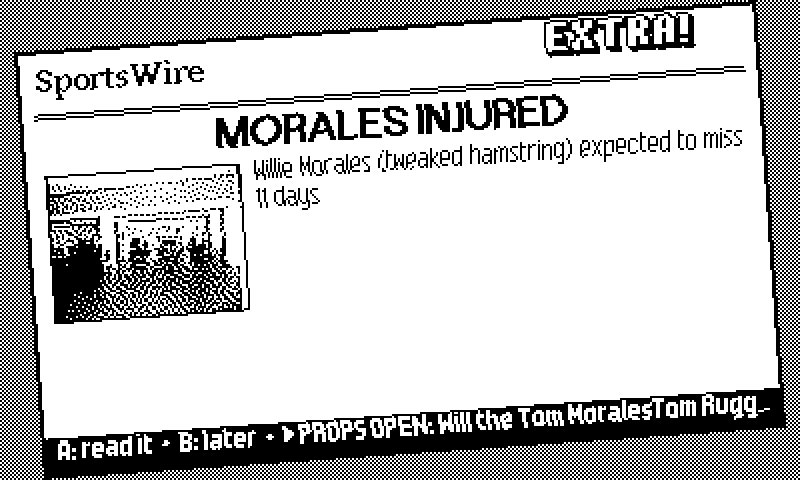
  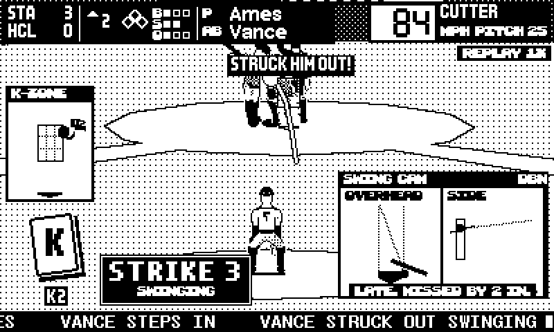
  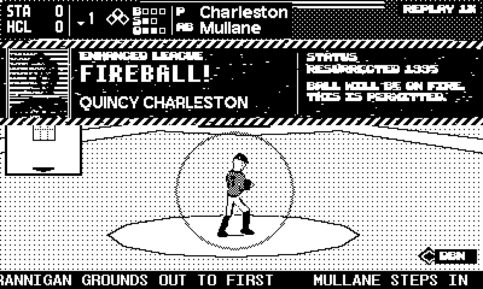
  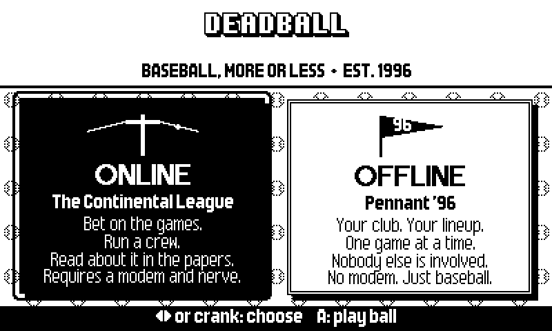
  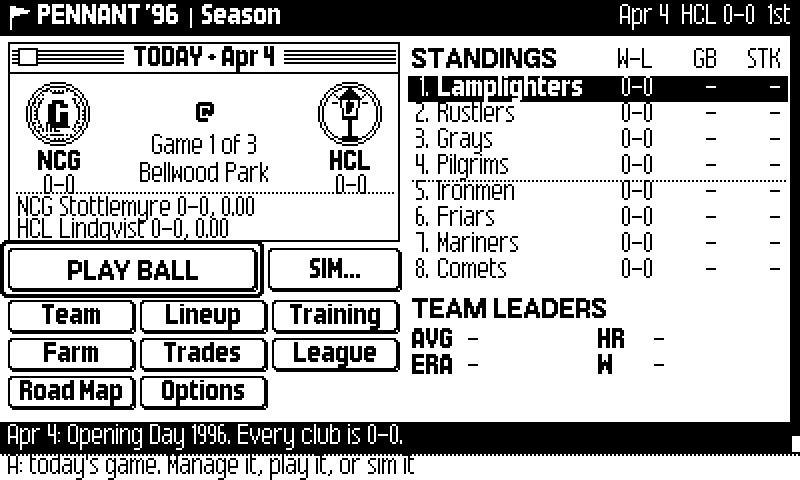
  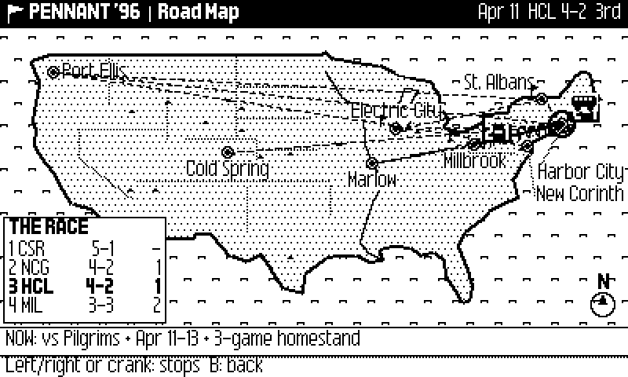
  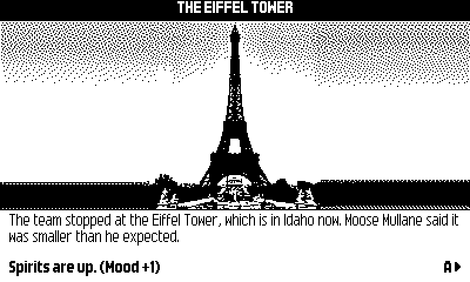
</p>

## Layout

- `playdate/` — the Playdate client (Lua in `source/`, C extension in `c/`: the BallCast
  renderer, request signing and the `pdsim` game engine)
- `packages/sim` — the league simulation (TypeScript)
- `packages/server` — the league server (Cloudflare Worker + Durable Object, D1, R2)
- `tools/` — asset and audio pipelines (Python)

## Build the game

Needs the [Playdate SDK](https://play.date/dev/) (at `~/Developer/PlaydateSDK`, or set `SDK=`)
and, for device builds, the Arm GNU toolchain.

```sh
cd playdate
make            # Simulator build -> build/deadball.pdx
make run        # build and open in the Simulator
make device     # device build; sideload build/deadball.pdx via play.date/account/sideload
```

Online play needs a build from the latest source; offline (Pennant '96) works with any build.

## Run the server locally

Node 22+.

```sh
npm install
npm test
cd packages/server
cp .dev.vars.example .dev.vars
npm run dev
```

Deploying your own league needs your own Cloudflare D1 database and R2 bucket (edit
`wrangler.jsonc`) and two secrets: `wrangler secret put ADMIN_TOKEN` and
`wrangler secret put SIM_SALT` (any long random string; it keeps results unpredictable).

## AI disclosure

DEADBALL is built with heavy use of generative AI. Nearly all of the code (the Playdate client,
the C renderer and engine, the TypeScript sim and server, and the asset and audio pipelines) and
the in-game writing were produced by Anthropic's Claude, working through Claude Code under the
direction of the human developer, who set the design, reviewed and playtested the results on
hardware, and drew the launcher art.

No generative image, music or voice models were used. Photos and faces come from public-domain
and openly licensed archives (see `docs/CREDITS.md`) and are cropped and dithered by scripts; the
3D player puppets are rendered from a CC0 mesh and CMU motion capture; the music is public-domain
tunes arranged and synthesized by scripts in `tools/audio/`.

## License

Code: MIT (see `LICENSE`). Art, photos, fonts, music and sound effects keep their own licenses and
attributions, listed in `docs/CREDITS.md`; the bitmap fonts come from the Playdate SDK under the
Playdate SDK License.
